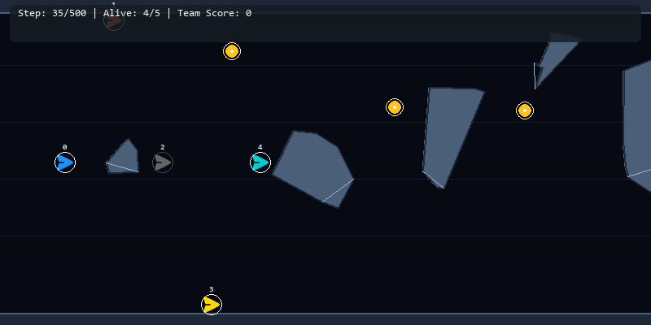

# ScrollSwarm

[](https://www.python.org/)
[](https://github.com/astral-sh/uv)
[](https://www.pygame.org/)
[](tests/)
[](README.md)

**A side-scrolling environment for cooperative multi-agent navigation, communication, and collection.**



ScrollSwarm is a lightweight, visualizable benchmark for studying how agents coordinate under **partial observability** (forward rangefinder perception) and **local graph communication** (chain graph with adjacent column teammates).

The world scrolls continuously from right to left at 1 pixel per timestep (30 FPS). Agents occupy fixed horizontal columns and navigate vertically (5 px per step) through an undulating mountain cavern to collect targets and avoid collisions.

---

## Quickstart

ScrollSwarm uses [uv](https://github.com/astral-sh/uv) for fast, reproducible dependency and environment management.

### Run Interactive Simulation
```bash
# Launch with default swarm (5 agents)
uv run python main.py

# Launch with custom swarm size (1 to 10 agents)
uv run python main.py -n 3
uv run python main.py -n 8
```

### Controls
| Key | Action |
| :--- | :--- |
| **`W` / `UP`** | Move focused agent up (5 px) |
| **`S` / `DOWN`** | Move focused agent down (5 px) |
| **`TAB`** / **`1`–`9`** | Switch active focused agent (white outline) |
| **`A`** | Move all alive agents synchronously |
| **`V`** | Toggle 7-ray LiDAR beam visualization |
| **`R`** | Restart simulation & reseed corridor |
| **`SPACE`** | Pause / Resume |
| **`ESC`** | Exit |

### Run Tests
```bash
uv run pytest
```

---

## Perception & Sensory Model

Agents perceive the upcoming environment through an ego-centric **7-ray forward LiDAR rangefinder** projecting into the oncoming half of the screen ($R_{\max} = 400\text{ px}$):

```text
               \   Ray 0: -60° (Ceiling / Top Boundary)
                \  Ray 1: -40°
                 \ Ray 2: -20°
Agent [>] ======= Ray 3:   0° (Horizontal Corridor) ===> (Oncoming Trees & Targets)
                 / Ray 4: +20°
                /  Ray 5: +40°
               /   Ray 6: +60° (Floor / Bottom Boundary)
```

### Observation Vector

At every timestep $t$, each agent receives a continuous 15-dimensional observation vector:

$$
\mathbf{o}_i = \left[ \frac{y_i}{H}, d_{\text{obs}, 0}, \dots, d_{\text{obs}, 6}, d_{\text{tgt}, 0}, \dots, d_{\text{tgt}, 6} \right] \in [0, 1]^{15}
$$

- **Self-State:** Normalized vertical coordinate $y_i / H \in [0, 1]$.
- **Obstacle Distances ($d_{\text{obs}, k}$):** Normalized distance to the nearest mountain boundary surface or circular tree canopy along ray $k$ ($1.0$ = clear path). Boundary clearances and obstacle warnings are unified into this single continuous channel.
- **Target Distances ($d_{\text{tgt}, k}$):** Normalized distance to the nearest collection target along ray $k$ ($1.0$ = no target).

---

## Multi-Scale Topography & Procedural Caverns

Rather than flat borders, ScrollSwarm features procedural, multi-scale undulating terrain designed to force genuine swarm maneuvers (climbing, diving, squeezing into single file):

1. **Centerline Meander (Climbs & Dives):**
   $$
   C(t) = \frac{H}{2} + A_1 \sin\left(\frac{2\pi t}{\lambda_1} + \phi_1\right) + A_2 \sin\left(\frac{2\pi t}{\lambda_2} + \phi_2\right)
   $$
   Sweeps the navigable channel vertically between high-altitude peaks and low valleys ($\lambda_1 = 540\text{ px}, A_1 = 65\text{ px}$; $\lambda_2 = 190\text{ px}, A_2 = 28\text{ px}$).

2. **Dynamic Chokepoints:**
   $$
   G(t) = \bar{G} + A_G \sin\left(\frac{2\pi t}{\lambda_G} + \phi_G\right)
   $$
   Pulses corridor width between tight gorges (130 px) and open basins (210 px).

3. **Stalactites & Stalagmites:**
   Occasional cosine-bell rock crags protruding 25 to 45 px from the ceiling or floor.

4. **Guaranteed Passage Invariant:**
   At every column $x$, clearance is strictly verified:
   $$
   \text{Gap}(x) = H - (h_{\text{top}}[x] + h_{\text{bot}}[x]) \ge G_{\min} \quad (110\text{ px})
   $$
   Safe vertical passage for the 14 px agents is mathematically guaranteed across the entire screen.

---

## Project Structure

```text
scrollswarm/
├── pyproject.toml         # Dependency & pytest configuration (uv-managed)
├── uv.lock                # Deterministic lockfile
├── README.md              # Project documentation
├── main.py                # Interactive 2D Pygame visualizer & demo runner
├── assets/
│   └── screenshot.png     # Gameplay preview render
├── objects/
│   ├── __init__.py        # Public module exports
│   ├── map.py             # Multi-scale topography, scrolling engine, and clearance invariant
│   ├── agent.py           # Agent entity, triangle geometry, and vertical dynamics (k = 5px)
│   ├── sensors.py         # 7-ray forward LiDAR rangefinder & observation vector
│   └── items.py           # Tree obstacles and collection target dataclasses
└── tests/
    ├── test_map.py        # Topography, 1px scrolling, culling, and clearance invariant tests
    ├── test_agent.py      # Movement (k=5px), collisions, clamping, and team creation tests
    └── test_sensors.py    # Raycasting math, boundary hits, entity detection, and vector shape tests
```

---

## Research Progression

1. **Single-Agent RL:** Can an individual agent learn to avoid boundary collisions and collect targets using the 7-ray LiDAR observation?
2. **Multi-Agent RL:** How does an uncoordinated team share collection objectives and navigate tight gorges without crowding?
3. **Graph MARL (Chain Communication):** Can upstream agents (who encounter bends and bottlenecks first) communicate predictive signals to downstream teammates along a chain graph?
4. **Robustness & Perturbation:** How does the swarm perform under noisy observations, communication dropouts, or adversarial perturbations?

---

## License

To be decided.
