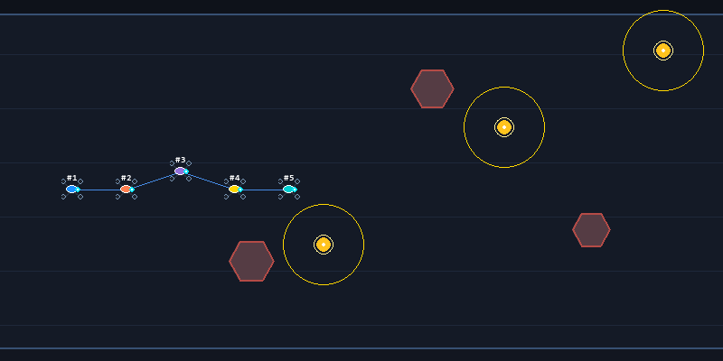

# ScrollSwarm

[](https://www.python.org/)
[](https://github.com/astral-sh/uv)
[](https://hambam.top/scrollswarm/)
[](https://pettingzoo.farama.org/)
[](tests/)
[](LICENSE)

**A 2D multi-agent reinforcement learning (MARL) testbed for cooperative UAV swarm reconnaissance, obstacle avoidance, and graph communication.**



ScrollSwarm is a 2D multi-agent simulation where a team of drones flies forward through an aerial corridor, dodging obstacles of different shapes and sizes while working together to take photos of targets along the way.

> **Documentation & API Reference:** Detailed guides and specifications are hosted at [https://hambam.top/scrollswarm/](https://hambam.top/scrollswarm/).

---

## Scenario Description

ScrollSwarm models a swarm of autonomous UAVs (drones) flying forward through an aerial corridor, where the vertical axis represents their flight altitude:

- **Movement & Controls:** The drones cruise forward in a straight line at a steady speed. Each drone simply chooses its vertical action at each step: **climb up**, **dive down**, or **maintain current altitude**.
- **Obstacles of Different Sizes:** 2D obstacles of varying shapes and sizes are distributed across the flight path. An open flight passage is always guaranteed through the corridor so drones never encounter blocked paths.
- **Observation & Target Missions:** Drones have the mission of observing specific target points along the way by flying close enough to photograph them.
- **Photo Quality & Redundancy:** Capturing a clear photo isn't guaranteed every time—we model image clarity with a probability that increases the closer a drone gets to the target. When targets are scattered across different altitudes, the team must coordinate to cover the entire space and provide redundancy, ensuring at least one drone successfully captures each target with sufficient quality.
- **Forward Perception & Communication:** Each drone uses 7 forward rangefinder rays (LiDAR) to spot oncoming obstacles ahead, tracks relative directions to nearby targets, and can share messages with teammates across configurable network graphs (chain, ring, spatial radius, or broadcast).
- **Safety:** Hitting any obstacle or corridor boundary immediately disables that drone, while the remaining team members continue the mission.

---

## Quickstart

ScrollSwarm is managed with [uv](https://github.com/astral-sh/uv) for fast, reproducible dependency management.

### Installation
```bash
git clone https://github.com/HamBa-m/scrollswarm.git
cd scrollswarm
uv sync
```

### Interactive Simulation
```bash
# Launch interactive visualizer (default: 5 UAVs, chain communication)
uv run python main.py

# Custom swarm size and communication topology
uv run python main.py -n 5 -c chain
uv run python main.py -n 8 -c ring
```

| Key | Action |
| :--- | :--- |
| **`W` / `UP`** | Vertical climb ($k = 5\text{ px}$) |
| **`S` / `DOWN`** | Vertical dive ($k = 5\text{ px}$) |
| **`TAB`** / **`1`–`9`** | Switch active focused UAV |
| **`A`** | Move all alive UAVs synchronously |
| **`V`** | Toggle 7-ray LiDAR beam visualization |
| **`C`** | Toggle graph communication data links |
| **`R`** | Restart simulation & reseed corridor |
| **`SPACE`** | Pause / Resume |
| **`ESC`** | Quit |

### Testing & Docs
```bash
# Run full unit test suite (45 tests)
uv run pytest

# Build documentation strictly
uv run mkdocs build --strict

# Serve local documentation site
uv run mkdocs serve
```

---

## Minimal Stepping Example

```python
import numpy as np
from scrollswarm import ScrollSwarmEnv

# 1. Initialize environment with 5 UAVs
env = ScrollSwarmEnv(num_agents=5, max_cycles=500, render_mode=None)
observations, infos = env.reset(seed=42)

for step in range(200):
    if not env.agents:
        break

    # 2. Sample discrete actions (0: UP, 1: STAY, 2: DOWN)
    actions = {agent: env.action_space(agent).sample() for agent in env.agents}

    # 3. Step environment
    observations, rewards, terminations, truncations, infos = env.step(actions)

    # 4. Extract PyG-compatible communication graph tensors
    edge_index, edge_attr = env.get_edge_index_and_attributes()

env.close()
```

---

## License

MIT License.
