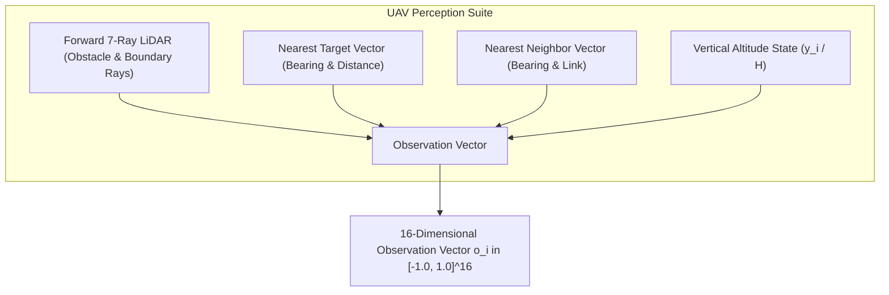

# Observation Space

This section formalizes the multi-modal sensory suite equipped on each UAV: the 7-ray forward LiDAR rangefinder, the stochastic camera target-inspection model, the complete 16-dimensional observation vector, and the centralized state space representation for Centralized Training with Decentralized Execution (CTDE).

---

## 1. Sensory Architecture Overview

Each UAV in ScrollSwarm operates under partial observability, constructing a local 16-dimensional observation vector $\mathbf{o}_i \in [-1.0, 1.0]^{16}$ from four components:

1. **Normalized Altitude State ($1$ float):** Normalized vertical flight coordinate $y_i / H \in [0.0, 1.0]$.
2. **Forward 7-Ray LiDAR ($7$ floats):** Rangefinder beam array measuring normalized intersection distances to approaching obstacles and corridor boundaries ($d_k^* / R_{\max} \in [0.0, 1.0]$).
3. **Target Tracking Vector ($4$ floats):** Relative horizontal displacement, vertical displacement, Euclidean distance, and photo inspection range indicator to the nearest unphotographed target.
4. **Neighbor Drone Vector ($4$ floats):** Relative horizontal displacement, vertical displacement, Euclidean distance, and communication connectivity indicator to the nearest living teammate.



---

## 2. 7-Ray Forward LiDAR Rangefinder

### 2.1 Theoretical Foundation: The Beam Model of Range Finders
Range sensing in ScrollSwarm builds on the **Beam Model of Range Finders** established in probabilistic mobile robotics ([Thrun, Burgard, & Fox, 2005](https://mitpress.mit.edu/9780262201629/probabilistic-robotics/), Chapter 6):

$$p(z \mid x, m) = \prod_{k=1}^K p(z_k \mid x, m)$$

Where an array of $K = 7$ range rays is projected from the UAV position $(x_i, y_i)$ into the oncoming corridor airspace.

### 2.2 Beam Geometry & Field of View
The 7 sensor beams span a forward field of view $\text{FOV} = 120^\circ$ centered horizontally forward along the direction of flight:

$$\theta_k = -\frac{\pi}{3} + k \cdot \frac{2\pi}{3(K - 1)}, \quad k \in \{0, 1, \dots, 6\}$$

$$\Theta = \big\{ -60^\circ, \;-40^\circ, \;-20^\circ, \;0^\circ, \;+20^\circ, \;+40^\circ, \;+60^\circ \big\}$$

- **Maximum Range:** $R_{\max} = 400.0\text{ px}$ (spanning the oncoming half of the $800\text{ px}$ corridor).
- **Beam Angle $\theta = 0^\circ$:** Projects horizontally forward to detect upcoming obstacles.
- **Beam Angles $\theta < 0$:** Point upward-forward to detect ceiling boundaries and overhead structures.
- **Beam Angles $\theta > 0$:** Point downward-forward to detect ground structures and terrain boundaries.

```
                  Ray 0 (-60°)  \
                  Ray 1 (-40°)   \
                  Ray 2 (-20°)    \
  UAV [x, y] ---------------------- Ray 3 (0°, Forward)
                  Ray 4 (+20°)    /
                  Ray 5 (+40°)   /
                  Ray 6 (+60°)  /
```

### 2.3 Ray-Casting & Determinant Intersection Math
For each beam $k$ with unit direction vector $\mathbf{u}_k = (\cos \theta_k, \sin \theta_k)$, the true range $d_k^*$ is computed as the minimum intersection distance across all environmental primitives:

$$d_k^* = \min \big( R_{\max}, \;t_{\text{ceil}}, \;t_{\text{floor}}, \;\min_{j} t_{\text{obs}, j} \big)$$

1. **Analytical Boundary Intersections:**
    
    If $\sin \theta_k < 0$, then:
    
    $$t_{\text{ceil}} = \frac{y_{\text{ceil}} - y_i}{\sin \theta_k}$$
    
    If $\sin \theta_k > 0$, then:
    
    $$t_{\text{floor}} = \frac{y_{\text{floor}} - y_i}{\sin \theta_k}$$
    
2. **Ray-Segment Determinant Intersection for Polygon Edges:**

    For a polygon edge with endpoints $\mathbf{v}_a = (x_a, y_a)$ and $\mathbf{v}_b = (x_b, y_b)$, the parametric ray $\mathbf{p}(t) = \mathbf{p}_0 + t \mathbf{u}_k$ and edge segment $\mathbf{e}(u) = \mathbf{v}_a + u(\mathbf{v}_b - \mathbf{v}_a)$ intersect when:
   
       $$t = \frac{(x_a - x_i)(y_b - y_a) - (y_a - y_i)(x_b - x_a)}{\cos \theta_k (y_b - y_a) - \sin \theta_k (x_b - x_a)}$$

    and

       $$u = \frac{(x_a - x_i)\sin \theta_k - (y_a - y_i)\cos \theta_k}{\cos \theta_k (y_b - y_a) - \sin \theta_k (x_b - x_a)}$$


   An intersection is valid if $0 \le t < R_{\max}$ and $0 \le u \le 1$.

3. **Normalization:**

       $$d_{\text{norm}, k} = \frac{d_k^*}{R_{\max}} \in [0.0, 1.0]$$

---

## 3. Stochastic Target Inspection & Camera Model

### 3.1 Proximity-Dependent Bernoulli Detection
Target observation is modeled as a stochastic inspection process under camera sensor uncertainty, following standard mobile sensor network models ([Cortés et al., 2004](https://doi.org/10.1109/TRA.2004.824698); [Beard & McLain, 2012](https://press.princeton.edu/books/hardcover/9780691149219/small-unmanned-aircraft)).

A target located at $(x_{\text{tgt}}, y_{\text{tgt}})$ can only be photographed if a drone $j$ is within the physical inspection radius:

$$d_j = \sqrt{(x_j - x_{\text{tgt}})^2 + (y_j - y_{\text{tgt}})^2} \le D_{\text{photo}} = 45.0\text{ px}$$

The probability of drone $j$ capturing a clear, high-quality photograph is a function of proximity and intrinsic sensor reliability:

$$P_j(\text{clear} \mid d_j) = \left( 1 - \frac{d_j}{D_{\text{photo}}} \right) \cdot \mu_{\text{sensor}}$$

Where:

- $D_{\text{photo}} = 45.0\text{ px}$ is the maximum photo radius.
- $\mu_{\text{sensor}} = 0.85$ models camera blur, lighting variations, and vibration disturbances.

### 3.2 Swarm Team Redundancy
When multiple living drones $\mathcal{N}_{\text{target}}$ are simultaneously within photo range of the target, their observations are conditionally independent Bernoulli trials:

$$P_{\text{team}}(\text{success}) = 1 - \prod_{j \in \mathcal{N}_{\text{target}}} \Big( 1 - P_j(\text{clear} \mid d_j) \Big)$$

If $X \sim \text{Bernoulli}(P_{\text{team}})$ yields $1$, the target is successfully photographed, marked completed, and awards the team inspection reward. This mathematical formulation naturally incentivizes multi-UAV team redundancy: if one drone is near the perimeter ($P_1 = 0.2$), a second drone flying close ($P_2 = 0.8$) elevates the team capture probability to:

$$P_{\text{team}} = 1 - (1 - 0.2)(1 - 0.8) = 1 - (0.8 \times 0.2) = 0.84$$

---

## 4. Complete 16-Dimensional Observation Vector

Each living agent receives a normalized 16-dimensional continuous feature vector $\mathbf{o}_i \in [-1.0, 1.0]^{16}$:

$$\mathbf{o}_i = \big[ y_{\text{norm}}, \;\mathbf{d}_{\text{LiDAR}}^\top, \;\mathbf{f}_{\text{target}}^\top, \;\mathbf{f}_{\text{neighbor}}^\top \big]^\top$$

| Index | Feature Symbol | Description | Mathematical Definition | Range |
| :---: | :---: | :--- | :---: | :---: |
| **`0`** | $y_{\text{norm}}$ | Normalized vertical flight altitude | $y_i / H$ | $[0.0, 1.0]$ |
| **`1`** | $d_{\text{LiDAR}, 0}$ | LiDAR Ray 0 distance (-60° up-forward) | $d_0^* / R_{\max}$ | $[0.0, 1.0]$ |
| **`2`** | $d_{\text{LiDAR}, 1}$ | LiDAR Ray 1 distance (-40° up-forward) | $d_1^* / R_{\max}$ | $[0.0, 1.0]$ |
| **`3`** | $d_{\text{LiDAR}, 2}$ | LiDAR Ray 2 distance (-20° up-forward) | $d_2^* / R_{\max}$ | $[0.0, 1.0]$ |
| **`4`** | $d_{\text{LiDAR}, 3}$ | LiDAR Ray 3 distance (0° horizontal forward) | $d_3^* / R_{\max}$ | $[0.0, 1.0]$ |
| **`5`** | $d_{\text{LiDAR}, 4}$ | LiDAR Ray 4 distance (+20° down-forward) | $d_4^* / R_{\max}$ | $[0.0, 1.0]$ |
| **`6`** | $d_{\text{LiDAR}, 5}$ | LiDAR Ray 5 distance (+40° down-forward) | $d_5^* / R_{\max}$ | $[0.0, 1.0]$ |
| **`7`** | $d_{\text{LiDAR}, 6}$ | LiDAR Ray 6 distance (+60° down-forward) | $d_6^* / R_{\max}$ | $[0.0, 1.0]$ |
| **`8`** | $\Delta x_{\text{tgt}}$ | Relative horizontal offset to nearest target | $(x_{\text{tgt}} - x_i) / W$ | $[-1.0, 1.0]$ |
| **`9`** | $\Delta y_{\text{tgt}}$ | Relative vertical offset to nearest target | $(y_{\text{tgt}} - y_i) / H$ | $[-1.0, 1.0]$ |
| **`10`** | $d_{\text{tgt}}$ | Normalized Euclidean distance to nearest target | $\|\mathbf{p}_{\text{tgt}} - \mathbf{p}_i\| / \sqrt{W^2 + H^2}$ | $[0.0, 1.0]$ |
| **`11`** | $\mathbf{1}_{\text{in\_range}}$ | Photo inspection range indicator | $\mathbf{1}_{d_{\text{tgt}} \le D_{\text{photo}}}$ | $\{0.0, 1.0\}$ |
| **`12`** | $\Delta x_{\text{nbr}}$ | Relative horizontal offset to nearest neighbor | $(x_{\text{nbr}} - x_i) / W$ | $[-1.0, 1.0]$ |
| **`13`** | $\Delta y_{\text{nbr}}$ | Relative vertical offset to nearest neighbor | $(y_{\text{nbr}} - y_i) / H$ | $[-1.0, 1.0]$ |
| **`14`** | $d_{\text{nbr}}$ | Normalized Euclidean distance to nearest neighbor | $\|\mathbf{p}_{\text{nbr}} - \mathbf{p}_i\| / \sqrt{W^2 + H^2}$ | $[0.0, 1.0]$ |
| **`15`** | $\mathbf{1}_{\text{comm}}$ | Inter-drone communication connectivity flag | $\mathbf{1}_{d_{\text{nbr}} \le R_{\text{comm}}}$ | $\{0.0, 1.0\}$ |

*(If no active targets exist, indices 8–11 default to $[0.0, 0.0, 1.0, 0.0]$. If no living neighbors exist, indices 12–15 default to $[0.0, 0.0, 1.0, 0.0]$).*

---

## 5. Centralized State Space for CTDE

For algorithms employing **Centralized Training with Decentralized Execution** (such as MAPPO, QMIX, and MADDPG), `env.state()` returns the global concatenated state vector:

$$\mathbf{s} = \big[ \mathbf{o}_1^\top, \;\mathbf{o}_2^\top, \;\dots, \;\mathbf{o}_N^\top \big]^\top \in \mathbb{R}^{16N}$$

- **State Space:** `spaces.Box(low=-1.0, high=1.0, shape=(16 * num_agents,), dtype=np.float32)`.
- **Dead Agent Zero-Masking:** If agent $i$ has crashed (`alive = False`), its corresponding slice in the state vector is replaced with zero: $\mathbf{o}_i = \mathbf{0}_{16} \quad \text{if } \text{alive}_i = \text{False}$.

---

## 6. References

1. **Thrun, S., Burgard, W., & Fox, D. (2005).** *Probabilistic Robotics.* MIT Press. Chapter 6: "Sensor Models: Beam Model of Range Finders". [MIT Press Link](https://mitpress.mit.edu/9780262201629/probabilistic-robotics/).
2. **Cortés, J., Martínez, S., Karatas, T., & Bullo, F. (2004).** *Coverage control for mobile sensing networks.* IEEE Transactions on Robotics and Automation, 20(2), 243–255. [DOI: 10.1109/TRA.2004.824698](https://doi.org/10.1109/TRA.2004.824698).
3. **Beard, R. W., & McLain, T. W. (2012).** *Small Unmanned Aircraft: Theory and Practice.* Princeton University Press. [Princeton Univ Press Link](https://press.princeton.edu/books/hardcover/9780691149219/small-unmanned-aircraft).
4. **Oliehoek, F. A., & Amato, C. (2016).** *A Concise Introduction to Decentralized POMDPs.* SpringerBriefs in Intelligent Systems, Springer. [DOI: 10.1007/978-3-319-28929-8](https://doi.org/10.1007/978-3-319-28929-8).
