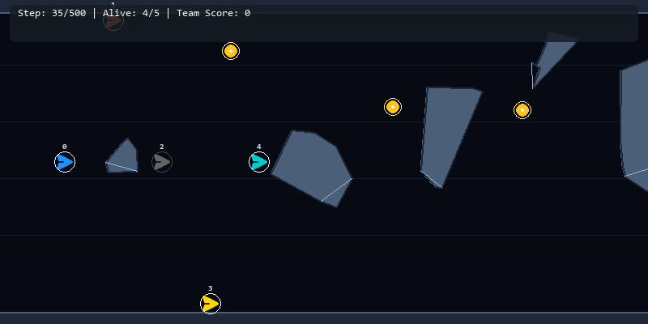
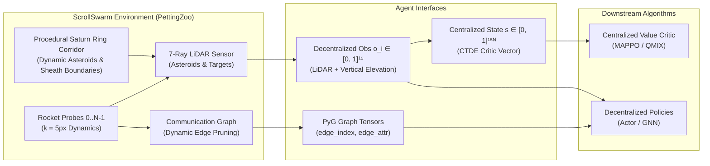

# ScrollSwarm: Multi-Agent RL Saturn Ring Surfing Testbed

**ScrollSwarm** is a side-scrolling multi-agent reinforcement learning (MARL) testbed engineered for evaluating decentralized coordination, graph communication, and spatial navigation through dynamic planetary rings under strict obstacle constraints.

---

## Key Research Highlights

- **PettingZoo `ParallelEnv` Standard Compliance:** Fully adheres to Farama Foundation's MARL standards with step transitions, truncation invariants, and CTDE global state vectors.
- **Dynamic Planetary Ring Environment:** Navigational corridor bounded by upper and lower radiation sheaths, populated by irregular polygon asteroids executing Keplerian drift and Hill's epicyclic vertical oscillations with mathematically guaranteed passage clearance ($G(x) \ge 110\text{ px}$).
- **Ego-Centric 7-Ray LiDAR Sensory Suite:** Unified continuous rangefinder ($\mathbf{o}_i \in [0, 1]^{15}$) mapping upcoming boundary sheaths, dynamic polygon asteroid edges via exact 2D determinant ray-segment intersection, and collection targets.
- **Dynamic Communication Graph Layer:** Flexible topology modeling (`chain`, `ring`, `full`, `radius`, `capped`) with real-time dead-agent edge pruning and native PyTorch Geometric (PyG) tensor exports (`edge_index`, `edge_attr`).
- **High-Throughput Headless Execution:** Capable of exceeding **670+ environment steps/sec** per single CPU core ($\approx 3,400$ agent steps/sec), scaling to over **10,000 steps/sec** in standard vectorized rollout runners.

---

## Architecture Overview

---

## Research Questions Explored

1. **Single-Agent Survival:** Can an ego-centric rocket probe learn reactive vertical navigation from 7-ray LiDAR rangefinders without global coordinates?
2. **Decentralized Flocking:** How do uncoordinated probes avoid crowding and catastrophic bottlenecks around approaching massive moonlets?
3. **Graph-Assisted Predictive Signaling:** Can upstream scout probes relay advance warnings (approaching fast shards, dense asteroid clusters, targets) to downstream teammates along a graph topology?
4. **Topology Resilience:** How does team performance degrade when communication links fail or probes are dynamically eliminated?
