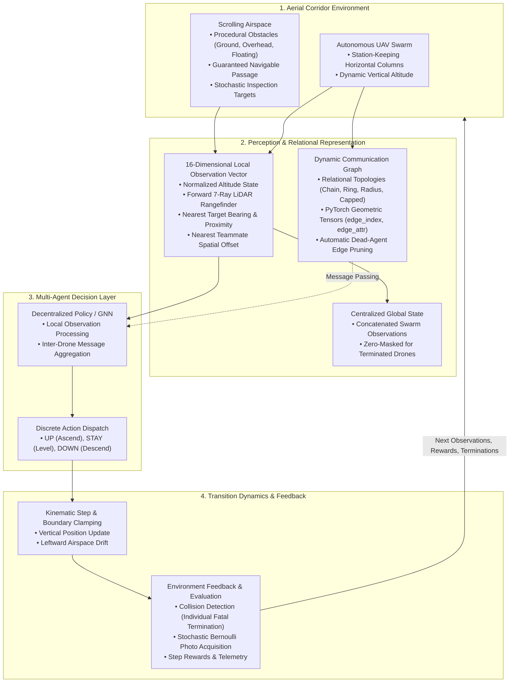

# ScrollSwarm

**A 2D multi-agent reinforcement learning (MARL) testbed for cooperative UAV swarm reconnaissance, obstacle avoidance, and graph communication.**

ScrollSwarm is a lightweight, high-throughput multi-agent simulation where a team of autonomous drones flies forward through an aerial corridor. Agents must dodge obstacles of various shapes and sizes while coordinating to take photos of targets scattered along their flight path.

---

## Scenario at a Glance

- **Airspace & Movement:** Drones cruise forward in a straight line at a constant speed ($v_{\text{scroll}} = 1\text{ px/step}$). The vertical axis represents flight altitude, and each drone controls its altitude with discrete actions: **climb up**, **dive down**, or **maintain height**.
- **Procedural Obstacles:** 2D obstacles of varying shapes and sizes are procedurally distributed across the corridor. An open flight passage is always guaranteed ($G_{\min} \ge 110\text{ px}$), ensuring drones never face impassable bottlenecks.
- **Reconnaissance & Photo Missions:** Drones have the mission of observing designated target waypoints by flying within inspection range ($D_{\text{photo}} = 45\text{ px}$).
- **Image Quality & Redundancy:** Capturing a clear photo isn't guaranteed—clarity is modeled probabilistically, improving as an agent gets closer to the target. When targets appear at different altitudes, the team must coordinate to provide redundancy ($P_{\text{team}} = 1 - \prod (1 - P_j)$), ensuring at least one drone captures each target.
- **Forward Rangefinder Vision:** Each drone is equipped with 7 forward sensor rays (LiDAR) to detect oncoming obstacles ahead, alongside relative bearings to the closest target and neighboring drones.
- **Graph Communication:** Living drones can pass messages to their teammates across configurable network graphs (chain, ring, spatial radius, or broadcast) with native PyTorch Geometric (PyG) tensor export.
- **Safety:** Colliding with any obstacle or corridor boundary immediately disables that drone, while surviving teammates continue the mission.

---

## Core Architecture

---

## Key Highlights

| Feature | Description |
| :--- | :--- |
| **PettingZoo Standard** | Natively implements Farama's `ParallelEnv` for seamless integration with modern MARL libraries. |
| **CTDE Ready** | Exposes centralized state vectors ($\mathbb{R}^{16N}$) for centralized training with decentralized execution (MAPPO, QMIX, MADDPG). |
| **Graph Neural Networks** | Exports PyTorch Geometric compatible `edge_index` $(2, E)$ and `edge_attr` $(E, 3)$ tensors for relational GNN learning. |
| **High Throughput** | Exceeds **800+ environment steps/sec** per CPU core, scaling to over **12,000 steps/sec** in vectorized parallel runners. |
| **Pure Python & Zero Bloat** | Built with NumPy and Pygame—no heavy rendering engines or external simulator setups required. |

---

## Documentation Roadmap

- **[Installation](getting-started/installation.md):** Setup instructions with `uv` and standard `pip`.
- **[Quickstart & Visualizer](getting-started/quickstart.md):** Launch the interactive Pygame flight simulator and run a minimal 20-line stepping script.
- **[Environment Specification](environment/overview.md):** Formal Dec-POMDP formulation, kinematics, sensor geometry, and graph communication.
- **[Tutorials](tutorials/01_parallel_env.md):** Hands-on walkthroughs for PettingZoo loops, reactive heuristics, and GNN integration.
- **[API Reference](api/env.md):** Detailed class references and docstrings for all core modules.
