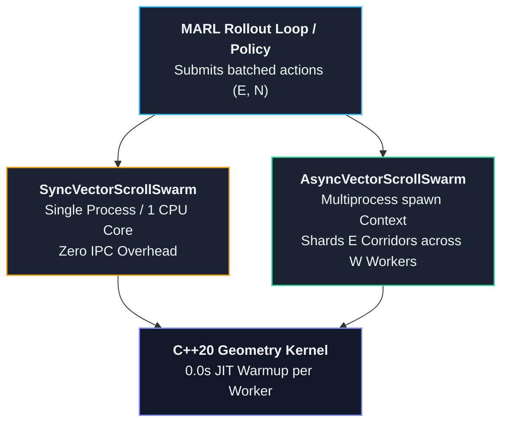
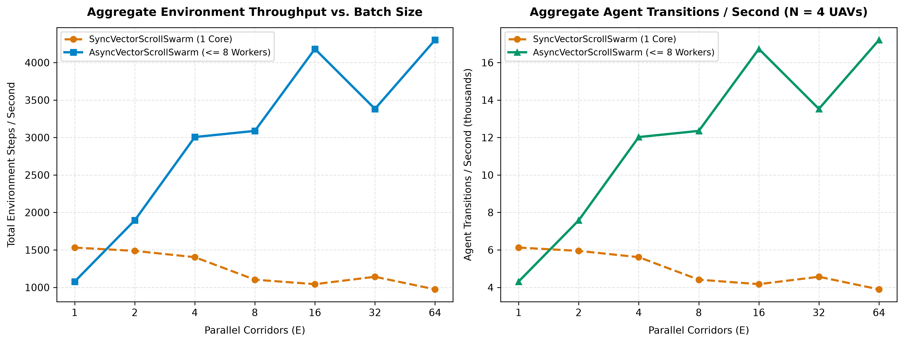

# Tutorial 05: Vectorized MARL Execution & Multi-Core Scaling

Modern Multi-Agent Reinforcement Learning (MARL) algorithms (MAPPO, QMIX, MADDPG, Relational GNNs) depend on parallel rollout collection across many independent episodes simultaneously.

This tutorial walks through `scrollswarm.vector` and explains:

1. **Why `(E, N)` Vectorization Matters:** Contrasting CTDE & graph-preserving batching against generic IPPO flattening (`SuperSuit`).
2. **Synchronous vs. Asynchronous Runners:** Choosing between `SyncVectorScrollSwarm` and multiprocess `AsyncVectorScrollSwarm`.
3. **Auto-Reset & Bootstrapping Semantics:** Handling `episode_done`, `alive_mask`, `final_observation`, and `final_state`.
4. **Block-Diagonal GNN Graph Batching:** Using `BaseVectorScrollSwarm.batch_graphs()` for PyTorch Geometric without cross-corridor edge leakage.
5. **Empirical Multi-Core Benchmarks:** Measuring pure environment throughput across $\mathcal{E} \in \{1, 2, 4, 8, 16, 32, 64\}$ corridors and analyzing the IPC crossover point.

---

## 1. Why Preserving `(E, N)` Structure Matters for CTDE & GNNs

Standard PettingZoo-to-Gymnasium vector wrappers (such as `supersuit.pettingzoo_env_to_vec_env_v1` + `concat_vec_envs_v1`) flatten $\mathcal{E}$ corridors of $N$ drones into a single flat axis `(E * N, 16)`. While suitable for decentralized Independent PPO (IPPO), flattening breaks two foundational ScrollSwarm abstractions:

1. **CTDE Centralized Critics:** Algorithms like MAPPO and QMIX require the true joint global state `(E, 16 * N)` plus per-agent liveness masks `(E, N)` — neither of which is exposed by Gymnasium's standard `VecEnv`.
2. **Relational Communication Graphs:** Graph policies require per-corridor adjacency matrices `(E, N, N)` or block-diagonal COO `edge_index` tensors so Drone $i$ in Corridor $e$ never exchanges messages with drones in Corridor $e'$.

`scrollswarm.vector` preserves explicit **`(E, N, ...)`** swarm dimensions on every `reset()` and `step()`.

---

## 2. Synchronous vs. Asynchronous Vector Runners



- **`SyncVectorScrollSwarm`:** Steps all $\mathcal{E}$ corridors sequentially in the main Python process. Best for unit testing, debugging, and very small batch sizes ($\mathcal{E} = 1$).
- **`AsyncVectorScrollSwarm`:** Spawns `num_workers` OS worker processes using Python's cross-platform `spawn` context, evenly sharding `num_envs` across workers. Pairing `AsyncVectorScrollSwarm` with `backend="cpp"` avoids Numba's per-worker JIT warmup lag across spawned processes.

---

## 3. Batched Rollout Loop & Auto-Reset Bootstrapping

When any corridor $e$ finishes (either every UAV collides or `step_count >= max_cycles`), `scrollswarm.vector` resets corridor $e$ **inside the same `step()` call** so the remaining $\mathcal{E} - 1$ corridors never stall:

- `obs[e]` immediately contains the **new episode's** initial observations (`alive_mask[e]` becomes all `True`).
- `infos["episode_done"][e]` is set to `True`.
- `infos["final_observation"][e]` and `infos["final_state"][e]` store the **terminal step's** post-step vectors so on-policy GAE critics can distinguish time-limit truncation (`truncations[e]`) from collision termination (`terminations[e]`) without corrupted bootstrap targets.

```python
import numpy as np
from scrollswarm import AsyncVectorScrollSwarm

with AsyncVectorScrollSwarm(
    num_envs=8,
    num_workers=4,
    num_agents=4,
    max_cycles=500,
    comm_topology="chain",
    backend="auto",
) as vec_env:
    obs, infos = vec_env.reset(seed=42)
    # obs: (8, 4, 16), infos["state"]: (8, 64), infos["alive_mask"]: (8, 4)

    for step_idx in range(200):
        actions = vec_env.action_space.sample()  # shape (8, 4)
        obs, rewards, terminations, truncations, infos = vec_env.step(actions)

        # Handle GAE bootstrapping when any corridor auto-resets
        if np.any(infos["episode_done"]):
            done_ids = np.where(infos["episode_done"])[0]
            terminal_states = infos["final_state"][done_ids]
            terminal_obs = infos["final_observation"][done_ids]
```

---

## 4. Block-Diagonal Graph Batching for PyTorch Geometric

Both `SyncVectorScrollSwarm` and `AsyncVectorScrollSwarm` return dense `(E, N, N)` adjacency and `(E, N, N, 3)` spatial edge features in `infos["adj"]` and `infos["edge_attr"]`. To pass all $\mathcal{E}$ dynamic swarm graphs into a GNN forward pass simultaneously, call `BaseVectorScrollSwarm.batch_graphs()`:

```python
from scrollswarm import SyncVectorScrollSwarm, BaseVectorScrollSwarm

with SyncVectorScrollSwarm(num_envs=4, num_agents=5, comm_topology="radius") as vec_env:
    obs, infos = vec_env.reset(seed=7)
    actions = vec_env.action_space.sample()
    obs, rewards, terms, truncs, infos = vec_env.step(actions)

    # Flatten (E, N, 16) node features -> (E * N, 16)
    node_features = obs.reshape(-1, 16)

    # Convert (E, N, N) graphs -> block-diagonal COO batch (zero corridor leakage)
    edge_index, edge_attr, batch = BaseVectorScrollSwarm.batch_graphs(
        infos["adj"], infos["edge_attr"]
    )

    print("Node features:", node_features.shape)  # (20, 16)
    print("edge_index:   ", edge_index.shape)     # (2, E_total)
    print("edge_attr:    ", edge_attr.shape)      # (E_total, 3)
    print("batch ptr:    ", batch.shape)          # (20,)
```

Every node in corridor $e$ receives index offset $e \cdot N$, ensuring dead-agent pruning and dynamic `RADIUS` topologies remain strictly isolated per environment.

---

## 5. Empirical Vector Scaling Benchmark (Pure Environment Stepping)

The script [`scripts/benchmark_vector.py`](https://github.com/HamBa-m/scrollswarm/blob/main/scripts/benchmark_vector.py) measures pure environment stepping throughput (zero neural-network overhead) across corridor batch sizes $\mathcal{E} \in \{1, 2, 4, 8, 16, 32, 64\}$:

```bash
uv run python scripts/benchmark_vector.py --steps 400 --num-agents 4
```

### Benchmark Results

The following results were obtained on a personal workstation with the following specs:

* CPU: Intel Core i7-11850H @ 2.50 GHz, 8 cores, 16 threads
* RAM: 32 GB
* Geometry backend: `cpp` (`backend="auto"`)
* Num agents per corridor ($N$): 4
* Steps per configuration: 400 (`warmup=20`, `max_workers=8`)



| Batch Size ($\mathcal{E}$) | Total UAVs ($\mathcal{E} \cdot N$) | Sync (env-steps/s) | Async (env-steps/s) | Async (agent-steps/s) | Async Batch Latency | Async vs. Sync |
| :---: | :---: | :---: | :---: | :---: | :---: | :---: |
| **$\mathcal{E} = 1$** | 4 | **1,531.4** | 1,078.0 | 4,311.9 | $0.928\text{ ms}$ | $0.70\times$ |
| **$\mathcal{E} = 2$** | 8 | 1,487.2 | **1,894.2** | 7,576.8 | $1.056\text{ ms}$ | **$1.27\times$** |
| **$\mathcal{E} = 4$** | 16 | 1,403.3 | **3,006.1** | 12,024.5 | $1.331\text{ ms}$ | **$2.14\times$** |
| **$\mathcal{E} = 8$** | 32 | 1,102.9 | **3,088.3** | 12,353.0 | $2.590\text{ ms}$ | **$2.80\times$** |
| **$\mathcal{E} = 16$** | 64 | 1,043.0 | **4,182.1** | 16,728.3 | $3.826\text{ ms}$ | **$4.01\times$** |
| **$\mathcal{E} = 32$** | 128 | 1,141.6 | **3,382.2** | 13,528.8 | $9.461\text{ ms}$ | **$2.96\times$** |
| **$\mathcal{E} = 64$** | 256 | 973.8 | **4,301.3** | **17,205.1** | $14.879\text{ ms}$ | **$4.42\times$** |

### Key Systems Insights

1. **The IPC Crossover at $\mathcal{E} = 1$ vs. $\mathcal{E} \ge 2$:** At $\mathcal{E} = 1$, `SyncVectorScrollSwarm` ($1,531\text{ env-steps/s}$) outperforms `AsyncVectorScrollSwarm` ($1,078\text{ env-steps/s}$) because `Pipe` IPC serialization costs $\approx 0.28\text{ ms/step}$ — comparable to the C++20 corridor step itself. As soon as $\mathcal{E} \ge 2$, parallel CPU execution outweighs IPC overhead.
2. **Multi-Core Throughput Scaling:** On a single core, `SyncVectorScrollSwarm` plateaus near $\sim 1,000\text{–}1,500$ aggregate env-steps/s regardless of $\mathcal{E}$. Sharding across 8 `Async` workers drives pure environment collection up to **$4,301.3\text{ env-steps/s}$ ($17,205.1\text{ agent-steps/s}$)** at $\mathcal{E} = 64$ — a **$4.42\times$ speedup** over `Sync` (bounded by Python object/serialization overhead rather than raw geometry compute).
3. **Why Neural Training Amplifies This Further:** In an actual PyTorch PPO/GNN loop, stepping $\mathcal{E} = 16\text{–}64$ corridors supplies `(64, 4, 16)` / `256`-node batches in a single tensor evaluation ($14.9\text{ ms}$ env step), amortizing PyTorch kernel-launch latency alongside multi-core environment stepping.

---

## 6. Runner Selection Matrix

| Use Case | Recommended Runner | Rationale |
| :--- | :--- | :--- |
| **Single-Corridor Debugging / Rendering** | `ScrollSwarmEnv` | Direct PettingZoo `ParallelEnv` access and Pygame display. |
| **Small-Batch Prototyping ($\mathcal{E} \le 2$)** | `SyncVectorScrollSwarm` | Zero `spawn` startup latency and zero IPC overhead. |
| **Multi-Core MARL Training ($\mathcal{E} \ge 4$)** | `AsyncVectorScrollSwarm(..., backend="cpp")` | Scales across CPU cores with `0.0s` per-worker JIT warmup. |

### Next Steps

- Consult the [Vectorized Environments API Reference](../api/vector.md) for full signatures of `BaseVectorScrollSwarm`, `SyncVectorScrollSwarm`, and `AsyncVectorScrollSwarm`.
- Combine `batch_graphs()` with [Tutorial 03: PyG & GNN Integration](03_gnn_pyg.md) to run batched GNN message passing across parallel corridors.
